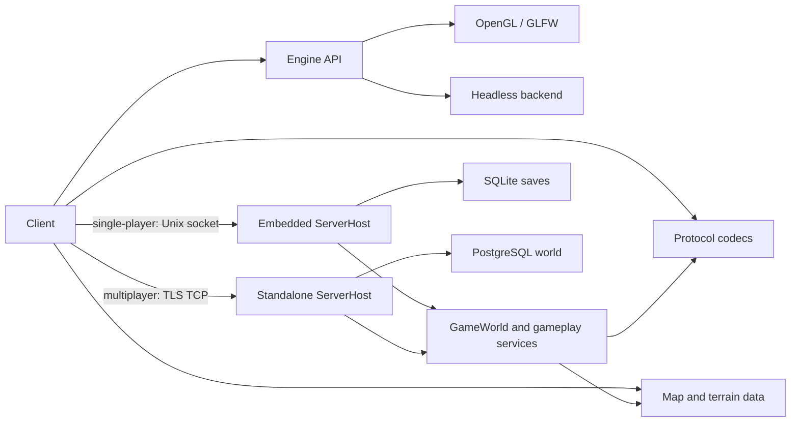

# OpenKal architecture

OpenKal is a Linux-first C++17 client and MainSvr. Game rules, persistence,
protocol encoding and map data are independent of the graphics backend.

## Modules

- `client/`: application states, network session, local/remote presentation,
  asset composition and UI hosts.
- `server/`: standalone MainSvr startup and deployment configuration.
- `libs/server/`: `ServerHost`, authoritative `GameWorld`, gameplay services,
  transport and persistence. Shared by standalone and embedded servers.
- `libs/protocol/`: opcodes, framing and packet codecs. Serialization has no
  socket or renderer dependency. OpenKal extensions use explicit payload contracts.
- `libs/map/`: `.akarea` attributes, coordinates, collision masks and streaming.
  Rendering and entity visibility remain outside this library.
- `libs/terrain/`: compatible model, texture and world-data readers.
- `libs/platform/`: paths, files, JSON, profiles, logging and packaged resources.
- `libs/settings/`: shared settings support.
- `engines/`: graphics/input contracts and backend implementations.
- `tools/`: asset inspectors, configuration editors and conversion utilities.

## Client and engine

`OPENKAL_ENGINE=gl` selects GLFW, GLEW and OpenGL 3.3. `null` supports headless
builds and tests. These are the supported CMake backends; Godot is a possible
future backend, not a current dependency. The decision is recorded in
[ADR-0001](architecture/ADR-0001-engine-backend.md).

The main engine contract is `engines/include/openkal/engine/engine.h`. Domain
logic stays outside backend code. Presentation binds loaded meshes, textures,
skeletons and animations to client entities.

Client application states cover startup, account/character selection, loading
and the world session. UI layouts use `openkal.ui/v1` JSON, C++ host bindings and
FreeType text. Hosts own gameplay actions; layout documents own widget geometry
and presentation. HyperText artwork can be reused without a Lisp UI runtime.
See the [UI format](ui/TEMPLATE.md), [bindings](ui/VARIABLES.md) and
[editor](ui/EDITOR.md).

## Server authority and storage

Single-player embeds the same server used by MainSvr, communicating through a
Unix socket and persisting to SQLite. Multiplayer uses authenticated TLS TCP
and PostgreSQL. Only the server accesses the multiplayer database. A database
lease limits a world to one authoritative MainSvr process.

The server validates movement, combat, inventory mutations and rewards.
Presentation never determines ownership, prices or random results. Persistent
character IDs identify durable membership and records; runtime player IDs
identify visible entities. Guilds are multiplayer-only; parties are session state.

See [Multiplayer](Multiplayer.md), [TCP security](TcpSecurity.md),
[Parties](Party.md) and [Guilds](GuildPlan.md) for the operational contracts.

## Maps and resources

The shared map grid uses 32-pixel tiles, 256 tiles per cell and 8192 pixels per
cell axis. Each tile has independent 4x4 Blocked and NotMoveable masks.
`config/mapinfo.json` identifies maps and their cells. Server movement/spawning
and client presentation use these coordinates; indoor meshes and outdoor terrain
are presentation data, with server geometry used where authoritative collision
requires it. See [the area format](area-map-format.md).

Project configuration and owned RuntimeData ship in `config.pak`. At runtime an
existing loose `configuration_root` selects the complete configuration tree;
otherwise the archive is used. Loose and packaged trees are not merged per file.
Packaging and optional external data are described in
[Configuration package](architecture/CONFIG_PACKAGE_VFS.md) and the
[project README](../README.md).

Readers and protocol behavior are maintained from public interfaces, documented
formats, observable requirements and project-owned synthetic tests. Optional
external game data stays separate from the source distribution. Missing or
unsupported behavior is explicit; no proprietary source tree or hidden legacy
configuration fallback is required.

## Build and verification

Use the [README build commands](../README.md#build-and-test-without-external-data).
The project targets C++17. Keep a headless build available and run project-owned tests without
`OPENKAL_DATA_ROOT`; optional catalog tests are labeled `optional-user-data`.
Server behavior, protocol round trips and rendered presentation are verified
separately. Test fixtures and imported resources retain their provenance.
